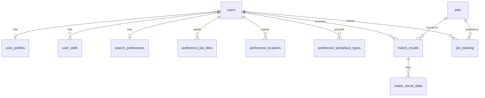

# Database (MySQL)

SQL scripts that create and update the MySQL database. The tables follow the fields agreed in [`documentation/DATA_CONTRACT.md`](../../documentation/DATA_CONTRACT.md). Requires MySQL 8.0.16 or newer, because older versions don't enforce `CHECK` rules. Aiven's MySQL is new enough.

```text
backend/db/
├── migrations/          # numbered change scripts, run in order
│   └── 001_create_tables.sql
└── seed/
    └── dev_seed.sql     # made-up example data, development only
```

## Set up a new development database

Use the same values as in `backend/.env`. The commands are run from the repo root and prompt for the password.

```bash
# 1. Create the tables (run every migration in number order)
mysql -h <DB_HOST> -P <DB_PORT> -u <DB_USER> -p <DB_NAME> < backend/db/migrations/001_create_tables.sql

# 2. (Optional) Load the example data
mysql -h <DB_HOST> -P <DB_PORT> -u <DB_USER> -p <DB_NAME> < backend/db/seed/dev_seed.sql
```

For Aiven, also add `--ssl-mode=REQUIRED`. If you'd rather use a GUI, open each file in MySQL Workbench and run it against the database.

Never load `dev_seed.sql` into a database that holds real users.

**Starting over:** migrations run once on an empty database. To reset a development database, drop all its tables (or drop and recreate the database), then run the steps above again.

## Changing the schema

1. **Never edit a migration that has already been merged.** Teammates have already run it, so their databases wouldn't get your edit.
2. Add a new file with the next number and a short name, for example `002_add_job_category.sql`. It should change the existing tables (`ALTER TABLE ...`, `CREATE TABLE ...`) rather than recreate them.
3. If the change adds or renames a field, update `documentation/DATA_CONTRACT.md` in the same pull request.
4. Update `dev_seed.sql` if the example data no longer fits.
5. Say in the PR description which new script teammates need to run.

After pulling `main`, run any migration files you haven't run yet, in number order.

## Tables

| Table | Primary key | Holds | Duplicate rules |
|---|---|---|---|
| `users` | `user_id` | Login email, password hash, created time | `email` is unique |
| `user_profiles` | `user_id` | Education and experience level | One profile per user |
| `user_skills` | `user_id`, `skill` | Profile skills, one row per skill | Same skill once per user |
| `search_preferences` | `user_id` | Salary range, currency, result count | One preferences row per user |
| `preference_job_titles` | `user_id`, `job_title` | Desired job titles | Same title once per user |
| `preference_locations` | `user_id`, `location` | Preferred locations | Same location once per user |
| `preference_workplace_types` | `user_id`, `workplace_type` | Acceptable `remote` / `hybrid` / `onsite` | Same type once per user |
| `jobs` | `job_id` | Standardized job postings | `source` + `external_job_id` is unique |
| `match_results` | `user_id`, `job_id` | Score (0–100), explanation, created time | One current result per user/job |
| `match_result_skills` | `user_id`, `job_id`, `skill` | Skills that matched for a result | Same skill once per result |
| `job_tracking` | `user_id`, `job_id` | `saved` / `dismissed` / `applied` status | One current status per user/job |

Text comparisons are case-insensitive, so `SQL` and `sql` count as the same skill.

The data contract's list fields (`skills`, `job_titles`, `locations`, `workplace_type`, `matched_skills`) are stored as one row per item in the matching table above. The API combines those rows back into JSON arrays.

## How the records connect



Deleting a user deletes all of their rows in the other tables. Deleting a job deletes its match results and tracking rows.

## Conventions

- Timestamps (`DATETIME`) are stored in UTC.
- Missing optional values are `NULL`, never `''`, `0`, or `'N/A'` (see the data contract).
- The allowed values for `education_level`, `experience_level`, `workplace_type`, and `status` are enforced with `ENUM` columns. Inserting any other value fails.
- Salaries are annual amounts stored as `DECIMAL(12,2)`, with the currency in a separate column.
