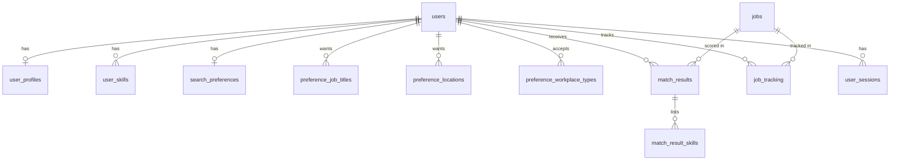

# Database (MySQL)

SQL scripts that create and update the MySQL database. The tables follow [`documentation/DATA_CONTRACT.md`](../../documentation/DATA_CONTRACT.md). Requires MySQL 8.0.16 or newer.

```text
backend/db/
├── migrations/
│   ├── 001_create_tables.sql
│   ├── 002_add_jobs_first_seen_at.sql
│   └── 003_create_user_sessions.sql
└── seed/
    └── dev_seed.sql
```

## Set up a new development database

Run from the repository root. The commands prompt for the database password.

```bash
mysql -h <DB_HOST> -P <DB_PORT> -u <DB_USER> -p <DB_NAME> < backend/db/migrations/001_create_tables.sql
mysql -h <DB_HOST> -P <DB_PORT> -u <DB_USER> -p <DB_NAME> < backend/db/migrations/002_add_jobs_first_seen_at.sql
mysql -h <DB_HOST> -P <DB_PORT> -u <DB_USER> -p <DB_NAME> < backend/db/migrations/003_create_user_sessions.sql
```

For Aiven, also add `--ssl-mode=REQUIRED`. In MySQL Workbench, select the target schema and run each migration in the same order.

The session migration uses `CREATE TABLE IF NOT EXISTS`. This also makes it safe to run on a development database where the session table was already created by the earlier, conflicting `002_create_tables.sql` filename. Do not rerun migrations `001` or `002` against an existing database; migrations are intended to run once, in order.

Optionally load made-up development data:

```bash
mysql -h <DB_HOST> -P <DB_PORT> -u <DB_USER> -p <DB_NAME> < backend/db/seed/dev_seed.sql
```

Never load `dev_seed.sql` into a database containing real users.

## Changing the schema

1. Never edit a migration that has already been merged or applied by teammates.
2. Add a new migration with the next number and a descriptive name.
3. Update `documentation/DATA_CONTRACT.md` when fields or shared data conventions change.
4. Update `dev_seed.sql` if the example data no longer fits.
5. State in the PR which migration teammates need to run.

## Tables

| Table | Primary key | Holds |
|---|---|---|
| `users` | `user_id` | Login email, password hash, creation time |
| `user_profiles` | `user_id` | Education and experience level |
| `user_skills` | `user_id`, `skill` | Profile skills |
| `search_preferences` | `user_id` | Salary range, currency, result count |
| `preference_job_titles` | `user_id`, `job_title` | Desired job titles |
| `preference_locations` | `user_id`, `location` | Preferred locations |
| `preference_workplace_types` | `user_id`, `workplace_type` | Acceptable workplace arrangements |
| `jobs` | `job_id` | Standardized job postings |
| `match_results` | `user_id`, `job_id` | Match score, explanation, creation time |
| `match_result_skills` | `user_id`, `job_id`, `skill` | Skills that matched |
| `job_tracking` | `user_id`, `job_id` | Saved, dismissed, or applied status |
| `user_sessions` | `session_id` | Hashed session token, activity, expiration, and revocation state |

The `user_sessions` table stores only the SHA-256 hash of each session token. `last_activity_at` supports the 30-minute idle timeout, `expires_at` enforces the seven-day absolute lifetime, and `revoked_at` records logout revocation. The table indexes `token_hash`, `user_id`, and `expires_at`; deleting a user cascades to their sessions.

## How the records connect



Deleting a user deletes all of their rows in the other tables, including their authentication sessions. Deleting a job deletes its match results and tracking rows.

## Conventions

- `DATETIME` timestamps are stored in UTC.
- Missing optional values are `NULL`, not empty strings, zero, or `N/A`.
- Enumerated fields are enforced by MySQL `ENUM` columns.
- Salaries are annual `DECIMAL(12,2)` values with currency stored separately.
- List fields in the data contract are stored as one row per item and combined by the API.

## Known limitations

- Deleting a job also deletes users' saved/applied rows for it. Do not delete expired jobs until a soft-delete field is designed.
- The backend must validate that required profile lists contain at least one item; the database cannot enforce that cross-row rule.


## AI use

The database code and documentation (JH-005: `migrations/001_create_tables.sql`, `seed/dev_seed.sql`, and this README) was generated with the help of Claude (Claude Code). This transcript [https://claude.ai/artifact/2KjzB62VP41MYZnzSA9vuH](https://claude.ai/artifact/2KjzB62VP41MYZnzSA9vuH) documents the GenAI interaction that led to my code.
